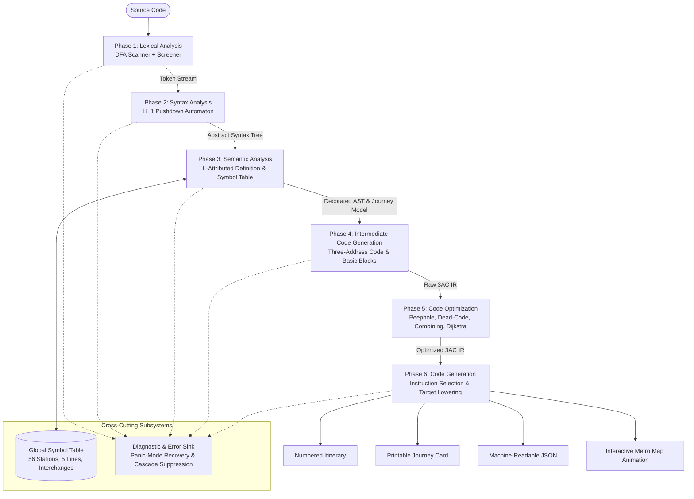
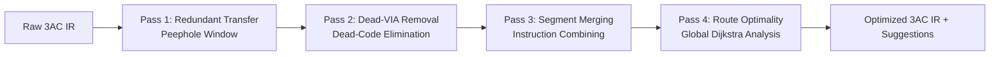

# MetroCC: Comprehensive Architectural & Compiler Design Summary

> **An Interactive Domain-Specific Compiler for Delhi Metro Journeys**  
> *Formally mapping Automata Theory, Formal Grammars, and Modern Compiler Construction to Real-World Urban Transit.*

---

## Table of Contents
1. [Executive Project Overview](#1-executive-project-overview)
2. [Compiler Architecture & The Five/Six Phase Model](#2-compiler-architecture--the-fivesix-phase-model)
3. [Phase 1: Lexical Analysis (Scanning & Screening)](#3-phase-1-lexical-analysis-scanning--screening)
4. [Phase 2: Syntax Analysis (LL(1) PDA Parsing & AST Construction)](#4-phase-2-syntax-analysis-ll1-pda-parsing--ast-construction)
5. [Phase 3: Semantic Analysis (L-Attributed Checking & Symbol Table)](#5-phase-3-semantic-analysis-l-attributed-checking--symbol-table)
6. [Phase 4: Intermediate Code Generation (Three-Address Code & CFG)](#6-phase-4-intermediate-code-generation-three-address-code--cfg)
7. [Phase 5: Code Optimization (Peephole, Dead Code, Combining & Graph Analysis)](#7-phase-5-code-optimization-peephole-dead-code-combining--graph-analysis)
8. [Phase 6: Code Generation & Multi-Target Lowering](#8-phase-6-code-generation--multi-target-lowering)
9. [Cross-Cutting Infrastructure: Symbol Table & Diagnostics](#9-cross-cutting-infrastructure-symbol-table--diagnostics)
10. [Verification, Test Suite & Quality Assurance](#10-verification-test-suite--quality-assurance)
11. [Viva & Technical Interview Defense Guide](#11-viva--technical-interview-defense-guide)

---

## 1. Executive Project Overview

**MetroCC** is a fully hand-crafted, zero-dependency domain-specific compiler and visual execution environment built in pure TypeScript. It compiles transit programs written in a custom Domain-Specific Language (DSL) into verified, optimized, and executable passenger itineraries across the Delhi Metro network.

```
       +--------------------------------------------------------------+
       |                     MetroCC Source DSL                       |
       |                                                              |
       |   BOARD Jahangirpuri ON Yellow AT 08:30;                     |
       |   VIA Kashmere Gate;                                         |
       |   CHANGE Violet AT Kashmere Gate;                            |
       |   EXIT Central Secretariat;                                  |
       +------------------------------+-------------------------------+
                                      |
                           [ MetroCC Pipeline ]
                                      |
       +------------------------------v-------------------------------+
       |                        Target Outputs                        |
       |   * Numbered Human Itinerary with platform directions        |
       |   * Formatted ASCII Printable Journey Ticket Card            |
       |   * Structured Machine-Readable JSON document                |
       |   * Real-time Animated Path on Schematic Metro Map           |
       +--------------------------------------------------------------+
```

### Core Engineering Highlights
* **Zero External Compiler Generators**: No Lex, Flex, Yacc, Bison, or ANTLR. The lexical analyzer, predictive LL(1) pushdown automaton, semantic checker, IR generator, optimizer, and target emitters are written by hand from first principles.
* **Pure Functional Core**: Every compiler stage is a pure function:
  $$\text{Phase}(Input) \to \{ ok: \text{boolean}, result: T, steps: S[], diagnostics: D[] \}$$
  This architecture enables step-by-step state visualization, interactive time-travel debugging, and complete determinism.
* **Real-World Transit Grounding**: Backed by a verified topological model of the Delhi Metro network containing 5 lines (Yellow, Red, Blue, Violet, Green), 56 stations, 6 major interchanges, real-world distance matrices, dwell times, and official DMRC fare slab calculation.

---

## 2. Compiler Architecture & The Five/Six Phase Model

### Classical Five-Phase vs. Concrete Six-Phase Compiler Taxonomy

In standard computer science textbooks (such as Aho, Lam, Sethi, Ullman — the "Dragon Book"), compilers are conceptually presented either in **5 classical phases** or broken down into **6 modular phases**:

| Classical 5-Phase Model | MetroCC 6-Phase Implementation | Primary Responsibility in MetroCC |
|---|---|---|
| **Phase 1: Lexical Analysis** | **Phase 1: Lexer (Scanner + Screener)** | Converts character stream into validated tokens using a 10-state DFA + keyword screener. |
| **Phase 2: Syntax Analysis** | **Phase 2: Parser (LL(1) PDA)** | Verifies grammar structure using an LL(1) pushdown automaton; builds Parse Tree and AST. |
| **Phase 3: Semantic Analysis** | **Phase 3: Semantic Analyzer** | Enforces context-sensitive graph constraints via an L-attributed grammar and Symbol Table. |
| **Phase 4: Intermediate Code & Optimization** | **Phase 4: IR Generation**<br>&<br>**Phase 5: Code Optimization** | Lowers AST to target-independent 3-Address Code (3AC) and basic blocks.<br>Performs 4 optimization passes (peephole, dead code, combining, Dijkstra). |
| **Phase 5: Code Generation** | **Phase 6: Multi-Target Codegen** | Selects target templates; computes running clock and fare slabs; emits Itinerary, Card, and JSON. |



---

## 3. Phase 1: Lexical Analysis (Scanning & Screening)

### Theoretical Foundation
Lexical analysis represents Chomsky Type-3 (Regular Languages). The language tokens are formally specified using Regular Expressions and recognized by a single Deterministic Finite Automaton (DFA) utilizing the **Maximal Munch** (longest match) rule.

### Two-Stage Architecture: Scanner + Screener (Dragon Book §3.4.3)
In urban transit languages, station names often span multiple words (e.g., `Kashmere Gate`, `Central Secretariat`, `Sector 18`). Hardcoding station dictionaries into the lexical scanner violates phase separation and bloats DFA state complexity. 

MetroCC solves this with an elegant two-stage design:
1. **DFA Scanner**: Recognizes pure regular lexical primitives without any station knowledge:
   * $\text{WORD} = [A\text{-}Za\text{-}z0\text{-}9][A\text{-}Za\text{-}z0\text{-}9'.-]^*$
   * $\text{TIME} = [0\text{-}9]+ : [0\text{-}9]+$
   * $\text{SEMI} = ;$
   * $\text{QUOTED} = "[\hat{\ }" \backslash n]*"$
   * $\text{COMMENT} = // [\hat{\ }\backslash n]*$
   * $\text{WHITESPACE} = [\ \backslash t\backslash r\backslash n]+$
2. **Screener**:
   * Scans the raw token stream on the same line.
   * Matches case-sensitive reserved keywords (`BOARD`, `ON`, `VIA`, `CHANGE`, `AT`, `EXIT`).
   * Concatenates adjacent non-keyword words separated by horizontal whitespace into a single compound `NAME` token (e.g. `Kashmere` + `Gate` $\to$ `NAME("Kashmere Gate")`).
   * Multi-word tokens never merge across newline boundaries, preventing cascading semicolon omissions.

### DFA State Machine Specification
The scanner DFA $M = (Q, \Sigma, \delta, q_0, F)$ operates over 10 distinct states:

| State | Label | Type | Token Accepted | Invariant / Description |
|---|---|---|---|---|
| $q_0$ | `q0` | Start | None | Initial state; no characters consumed. |
| $q_1$ | `q_word` | Accepting | `WORD` | Consuming alphanumeric characters or punctuation (`-`, `'`, `.`). |
| $q_2$ | `q_ws` | Accepting | `WS` | Run of whitespace/tabs/newlines (discarded). |
| $q_3$ | `q_semi` | Accepting | `SEMI` | Statement terminator `;` recognized. |
| $q_4$ | `q_slash` | Non-accepting | None | Saw initial `/`; awaits second `/` for comment. |
| $q_5$ | `q_comment` | Accepting | `COMMENT` | Consuming characters up to newline (`\n`). |
| $q_6$ | `q_quote` | Non-accepting | None | Inside quoted string literal; awaiting closing `"`. |
| $q_7$ | `q_qend` | Accepting | `QUOTED` | Closing quote matched; emits clean string. |
| $q_8$ | `q_num` | Accepting | `WORD` | Leading digits consumed (e.g. `Sector 18` or start of departure time). |
| $q_9$ | `q_colon` | Non-accepting | None | Digits followed by `:`; must be followed by minute digits. |
| $q_{10}$ | `q_time` | Accepting | `TIME` | Valid departure time recognized (e.g., `08:30`). |

### Lexical Diagnostics & Panic Mode
When the DFA halts in a non-accepting state (e.g., lone `/` at $q_4$, unclosed quote at $q_6$, or dangling colon `08:` at $q_9$), the scanner records an error with line and column span, skips the invalid sequence in panic mode, and resumes scanning at $q_0$.

* **Error Codes**: `L01` (Illegal character), `L02` (Unterminated string), `L03` (Empty string `""`), `L04` (Lone slash), `L05` (Block comments disallowed), `L06` (Incomplete timestamp).
* **Warnings**: `W-L01` (BOM detected), `W-L02` (Non-breaking space), `W-L10` (Lowercase keyword detected), `W-L11` (Misspelled keyword suggestion).

---

## 4. Phase 2: Syntax Analysis (LL(1) PDA Parsing & AST Construction)

### Theoretical Foundation
Syntax analysis verifies context-free structure (Chomsky Type-2). MetroCC uses an **LL(1)** predictive top-down parser implemented as a deterministic **Pushdown Automaton (PDA)** with zero backtrack overhead and linear $O(n)$ time complexity.

### Grammar Definition & Transformation
Left-recursive grammars cannot be parsed by LL(1) top-down parsers because they trigger infinite descent. The original grammar $route\_stmt^*$ is rewritten into right-recursive form with an explicit $\epsilon$-production:

$$\begin{aligned}
\langle program \rangle &\to \langle board\_stmt \rangle\ \langle route\_list \rangle\ \langle exit\_stmt \rangle \\
\langle board\_stmt \rangle &\to \text{BOARD}\ \langle station \rangle\ \text{ON}\ \langle line \rangle\ \langle depart \rangle\ \text{";"} \\
\langle depart \rangle &\to \text{AT}\ \text{TIME} \mid \epsilon \\
\langle route\_list \rangle &\to \langle route\_stmt \rangle\ \langle route\_list \rangle \mid \epsilon \\
\langle route\_stmt \rangle &\to \langle via\_stmt \rangle \mid \langle change\_stmt \rangle \\
\langle via\_stmt \rangle &\to \text{VIA}\ \langle station \rangle\ \text{";"} \\
\langle change\_stmt \rangle &\to \text{CHANGE}\ \langle line \rangle\ \text{AT}\ \langle station \rangle\ \text{";"} \\
\langle exit\_stmt \rangle &\to \text{EXIT}\ \langle station \rangle\ \text{";"} \\
\langle station \rangle &\to \text{NAME} \\
\langle line \rangle &\to \text{NAME}
\end{aligned}$$

### FIRST and FOLLOW Sets
Computed via fixed-point iteration algorithm until convergence:

| Non-Terminal ($A$) | $\text{FIRST}(A)$ | $\text{FOLLOW}(A)$ |
|---|---|---|
| `program` | { `BOARD` } | { `$` } |
| `board_stmt` | { `BOARD` } | { `VIA`, `CHANGE`, `EXIT` } |
| `depart` | { `AT`, $\epsilon$ } | { `;` } |
| `route_list` | { `VIA`, `CHANGE`, $\epsilon$ } | { `EXIT` } |
| `route_stmt` | { `VIA`, `CHANGE` } | { `VIA`, `CHANGE`, `EXIT` } |
| `via_stmt` | { `VIA` } | { `VIA`, `CHANGE`, `EXIT` } |
| `change_stmt` | { `CHANGE` } | { `VIA`, `CHANGE`, `EXIT` } |
| `exit_stmt` | { `EXIT` } | { `$` } |

### LL(1) Conflict-Free Proof
A grammar is LL(1) if and only if for every production $A \to \alpha \mid \beta$:
1. $\text{FIRST}(\alpha) \cap \text{FIRST}(\beta) = \emptyset$
2. If $\beta \Rightarrow^* \epsilon$, then $\text{FIRST}(\alpha) \cap \text{FOLLOW}(A) = \emptyset$

For MetroCC:
$$\text{FIRST}(\langle route\_stmt \rangle\ \langle route\_list \rangle) \cap \text{FOLLOW}(\langle route\_list \rangle) = \{\text{VIA}, \text{CHANGE}\} \cap \{\text{EXIT}\} = \emptyset$$
$$\text{FIRST}(\text{AT}\ \text{TIME}) \cap \text{FOLLOW}(\langle depart \rangle) = \{\text{AT}\} \cap \{;\} = \emptyset$$

The table generator (`ll1Table.ts`) algorithmically validates this: **0 conflicts detected**.

### LL(1) Predictive Parsing Table $M[A, a]$

| Non-Terminal | `BOARD` | `ON` | `VIA` | `CHANGE` | `AT` | `EXIT` | `NAME` | `TIME` | `;` | `$` |
|---|---|---|---|---|---|---|---|---|---|---|
| **program** | $P_1$ | | | | | | | | | |
| **board_stmt** | $P_2$ | | | | | | | | | |
| **depart** | | | | | $P_{10}$ | | | | $P_{11}$ ($\epsilon$) | |
| **route_list** | | | $P_3$ | $P_3$ | | $P_4$ ($\epsilon$) | | | | |
| **route_stmt** | | | $P_5$ | $P_6$ | | | | | | |
| **via_stmt** | | | $P_7$ | | | | | | | |
| **change_stmt** | | | | $P_8$ | | | | | | | |
| **exit_stmt** | | | | | | $P_9$ | | | | |

### Pushdown Automaton (PDA) Execution & Panic-Mode Recovery
* **Initial Configuration**: $([\$, program], w\$)$
* **Accepting Configuration**: $([\$], \$)$
* **Error Recovery**:
  1. If terminal mismatch: pop expected terminal as if inserted, log error, continue.
  2. If empty table cell $M[A, a]$: check if $a \in \text{FOLLOW}(A)$. If so, pop non-terminal $A$ (synchronization).
  3. Otherwise: discard lookahead tokens until finding a synchronization token (`;`).
  4. Cascade suppression: Suppresses consequential secondary errors until the next valid match.

---

## 5. Phase 3: Semantic Analysis (L-Attributed Checking & Symbol Table)

### Theoretical Foundation
Context-free grammars cannot enforce context-sensitive semantic truths (e.g., "Is Rajiv Chowk actually on the Yellow Line?", "Are stations visited in monotonic physical order along the line?", "Is Kashmere Gate a valid interchange to the Violet Line?").

MetroCC formulates semantic checking as an **L-Attributed Grammar Definition** evaluated in a single deterministic left-to-right traversal over the AST.

```
       [AST Statement Node]
             |
             +---> Inherited Attributes (flow down / left-to-right):
             |       * line.in   : Current active metro line
             |       * pos.in    : Current physical station position
             |       * dir.in    : Active directional vector (+1 / -1)
             |
             +---> Synthesized Attributes (computed & flow upward):
                     * stops     : Hop count along line
                     * km        : Track distance traversed
                     * dir       : Inferred orientation towards terminus
                     * status    : Pass / Fail / Warn validation code
```

### Global Symbol Table Architecture
The Symbol Table (`symbolTable.ts`) acts as the single source of truth for the physical transit network. It is pre-populated with:
* **Lines Scope**: Line IDs, terminal endpoints (`towards`), physical branches, hex theme colors.
* **Stations Scope**: Canonical station IDs, line membership sets, interchange capabilities, alternate/former name aliases (e.g. `Race Course` $\to$ `Lok Kalyan Marg`).
* **Reference Index**: Every occurrence of a station or line is linked to its exact source code `Span` for reciprocal IDE highlighting.

### Semantic Validation Rules
The analyzer executes 14 discrete verification passes:
1. **Name Resolution**: Verifies existence of station (`S01`) and line (`S02`). Employs Levenshtein distance typo matching (e.g. `Rajiv Chok` $\to$ *"Did you mean Rajiv Chowk?"*).
2. **Entity Role Consistency (`S03`)**: Rejects stations used where lines are expected (e.g. `ON Central Secretariat`) and vice versa.
3. **Boarding Connectivity (`S04`)**: Asserts boarding station lies on the specified boarding line.
4. **Line Continuity (`S05`)**: Asserts `VIA` stations exist on the currently ridden line.
5. **Interchange Reachability & Validity (`S06`, `S07`, `S08`)**: Asserts `CHANGE` station is reachable on current line, is a legitimate transfer point for the destination line, and is not a self-transfer.
6. **Alighting Validity (`S09`)**: Asserts `EXIT` station is physically on the active line.
7. **Monotonic Order & Direction Preservation (`S10`, `S11`)**: The first hop of a leg fixes the travel vector:
   $$\text{dir} = \text{sign}(\text{index}(to) - \text{index}(from)) \in \{+1, -1\}$$
   Subsequent stations on that leg must strictly adhere to $\text{dir}$. Reversals trigger `S11`.
8. **Branch Disjunction (`S12`)**: Detects illegal branch hops on branched lines (such as Green Line's Kirti Nagar vs. Inderlok spurs) without an interchange.
9. **Zero-Length Journey (`S13`)**: Flags journeys that exit without moving.
10. **Temporal Validity (`S14`, `W-S25`)**: Verifies 24-hour timestamp format and warns if travel falls outside DMRC operating hours (05:30–23:30).

---

## 6. Phase 4: Intermediate Code Generation (Three-Address Code & CFG)

### Theoretical Foundation
Intermediate Code Generation decouples the front-end language from target back-ends. MetroCC translates the verified AST into a linear, architecture-independent **Three-Address Code (3AC)** where every instruction has at most three operands.

### Three-Address Instruction Set Architecture (3AC)

| Opcode | Operands | Formal Semantics |
|---|---|---|
| `BOARD` | $line,\ station\ [, \text{time}]$ | Initializes journey state at origin station; sets departure clock. |
| `RIDE` | $line,\ from \to to$ | Physical transit hop along a line between contiguous stations. |
| `PASS` | $station$ | Static verification waypoint assertion (asserts route traversed station). |
| `TRANSFER` | $line_1 \to line_2\ @\ station$ | Interchange transfer between intersecting transit lines. |
| `ALIGHT` | $station$ | Journey termination at destination station. |

### Naive Translation Strategy
The translation is intentionally naive:
* Each `VIA` statement emits both a `RIDE` and a `PASS`.
* User-specified redundant transfers are emitted verbatim.
This deliberate separation mirrors industrial optimizing compilers (e.g. LLVM/GCC), allowing optimization passes in Phase 5 to perform semantics-preserving simplifications cleanly.

### Basic Block Partitioning & Control-Flow Graph (CFG)
The IR instruction sequence is partitioned into **Basic Blocks** using the classical Leader Algorithm:
1. **Leader Identification**:
   * Instruction 1 (`BOARD`) is a leader.
   * Any instruction immediately following a `TRANSFER` is a leader.
   * Target instructions of branch junctions are leaders.
2. **Block Construction**: Each basic block contains instructions from one leader up to, but not including, the next leader.
3. **CFG Structure**: Because metro journeys represent directed execution paths, the CFG links each line-ride block to subsequent line-ride blocks through transfer edges.

```
       +---------------------------------------------+
       | Basic Block B0 (Yellow Line)                |
       |   i0: BOARD    Yellow @ Jahangirpuri, 08:30 |
       |   i1: RIDE     Yellow, Jahangirpuri → KG    |
       |   i2: PASS     Kashmere Gate                |
       +----------------------+----------------------+
                              |
                     TRANSFER Yellow -> Violet
                              |
       +----------------------v----------------------+
       | Basic Block B1 (Violet Line)                |
       |   i3: TRANSFER Yellow → Violet @ KG         |
       |   i4: RIDE     Violet, KG → Mandi House     |
       |   i5: PASS     Mandi House                  |
       |   i6: RIDE     Violet, Mandi House → CS     |
       |   i7: ALIGHT   Central Secretariat          |
       +---------------------------------------------+
```

---

## 7. Phase 5: Code Optimization (Peephole, Dead Code, Combining & Graph Analysis)

### Theoretical Foundation
Code optimization transforms the intermediate representation to improve efficiency (reducing instruction count, transfers, and transit time) while strictly preserving program semantics.

MetroCC features four independent, toggleable optimization passes:



### Pass Details & Mechanics

#### 1. Redundant-Transfer Elimination (Peephole Optimization)
Scans a sliding window of instructions to eliminate wasteful transfers:
* **Immediate Reversal**: `TRANSFER A → B @ s; TRANSFER B → A @ s` $\to$ Deleted.
* **Transitive Collapsing**: `TRANSFER A → B @ s; TRANSFER B → C @ s` $\to$ `TRANSFER A → C @ s`.
* **Self-Transfer**: `TRANSFER A → A @ s` $\to$ Deleted.

#### 2. Dead-VIA Removal (Dead Code Elimination)
`PASS` instructions serve as static assertions during semantic analysis to prove the journey touched a waypoint. At runtime, a `PASS` performs no physical operation. This pass strips all `PASS` opcodes from the instruction stream.

#### 3. Segment Merging (Instruction Combining)
Fuses contiguous rides on the same line into a single uninterrupted ride:
$$\text{RIDE } L, A \to B\quad +\quad \text{RIDE } L, B \to C \quad \Longrightarrow \quad \text{RIDE } L, A \to C$$
*Crucial Pass Dependency*: Segment merging is blocked if an unpruned `PASS` instruction sits between the two rides. Hence, Pass 2 must precede Pass 3.

#### 4. Route-Optimality Analysis (Global Graph Analysis via Dijkstra)
Constructs a dual-layer transit multigraph where each station is duplicated per line:
* **Metric 1: Fastest Route** (edge weights = running minutes, interchange = 5 min).
* **Metric 2: Fewest Transfers** (interchange edge weight = 10,000 + 5 min, ensuring lexicographic minimization of transfers before time).
* **Semantic Invariance Principle**: An optimizing compiler must *never* mutate user intent. If the user intentionally routes via a scenic detour, the compiler optimizes their chosen route, but suggests the graph-optimal alternatives as loadable source code in the UI rather than silently rewriting their program.

---

## 8. Phase 6: Code Generation & Multi-Target Lowering

### Theoretical Foundation
Code Generation maps optimized intermediate representations into concrete target representations. Analogous to an industrial compiler targeting x86_64, ARM64, and WebAssembly from a single intermediate AST/LLVM bitcode, MetroCC lowers its optimized IR through a shared pipeline (`lowerToJourney`) into **three distinct targets**.

### The Three Code Generation Backends

```
                      +-----------------------------+
                      |       Optimized 3AC IR      |
                      +--------------+--------------+
                                     |
                                     | lowerToJourney()
                                     v
                      +-----------------------------+
                      |     Structured Journey      |
                      |   (Legs, Changes, Clocks)   |
                      +--------------+--------------+
                                     |
             +-----------------------+-----------------------+
             |                       |                       |
             v                       v                       v
     [ Backend 1: Text ]    [ Backend 2: Card ]     [ Backend 3: JSON ]
       itinerary.txt          journey-card.txt         journey.json
       Step-by-step human     ASCII printable          Machine-readable
       navigation guide       wallet-sized card        API document
```

#### 1. Numbered Human Itinerary (`itinerary.txt`)
Synthesizes plain-language instructions utilizing instruction templates:
* Maps `BOARD` and `TRANSFER` to platform signage ("Board Yellow towards Millennium City Centre Gurugram").
* Threads a running clock through each leg, calculating arrival timestamps.
* Adds transfer walking penalties (5 minutes per interchange).

#### 2. Printable Journey Card (`journey-card.txt`)
A fixed-width (50-character) formatted ASCII boarding ticket displaying:
* Origin, destination, departure, and estimated arrival times.
* Leg-by-leg breakdown with word-wrapped station listings.
* Overall metrics: total travel time, distance, station count, and official DMRC fare.

```
+--------------------------------------------------+
| METROCC JOURNEY CARD                             |
+--------------------------------------------------+
| From: Jahangirpuri                               |
| To:   Central Secretariat                        |
| Depart: 08:30               Arrive: ≈ 09:04      |
| Time:   34 min              Stops:  14           |
| Dist:   16.8 km             Fare:   ₹43          |
+--------------------------------------------------+
| LEG 1: Yellow Line (towards Millennium City Cen) |
| Jahangirpuri · Adarsh Nagar · Azadpur · Model    |
| Town · GTB Nagar · Vishwavidyalaya · Vidhan      |
| Sabha · Civil Lines · Kashmere Gate · Chandni    |
| Chowk · Chawri Bazar · New Delhi · Rajiv Chowk   |
| · Patel Chowk · Central Secretariat              |
+--------------------------------------------------+
```

#### 3. Machine-Readable JSON (`journey.json`)
Emits a validated `metrocc-journey` v1 specification for external mobile apps, automated turnstiles, or scheduling microservices.

### Financial & Physical Accuracy
* **DMRC Fare Slabs**: Official fare rules stipulate that fare is calculated strictly on the **shortest distance path** between entry and exit stations, regardless of passenger detours:
  $$\text{Fare Slabs: } \le 2\text{km}: ₹11,\ 2\text{-}5\text{km}: ₹21,\ 5\text{-}12\text{km}: ₹32,\ 12\text{-}21\text{km}: ₹43,\ 21\text{-}32\text{km}: ₹54,\ >32\text{km}: ₹64$$
* **Interactive Metro Map Animation**: Codegen extracts a sequence of polyline coordinate nodes that directly powers the front-end SVG animation engine, driving train simulations along the track.

---

## 9. Cross-Cutting Infrastructure: Symbol Table & Diagnostics

### Symbol Table Lifecycle
* Initialized once with Delhi Metro static topological data.
* Enriched dynamically during semantic evaluation with statement-level references.
* Queries support $O(1)$ lookups for stations, aliases, lines, and interchange nodes.

### Diagnostic Architecture
The compiler avoids crashing on syntax or semantic faults by channeling all issues into a unified `DiagnosticSink`:
* **Severity Levels**: `error` (blocks subsequent phases), `warning` (emitted without halting), `info` (contextual metadata, such as resolved aliases).
* **Source Spans**: Every diagnostic captures `{ start: { line, col }, end: { line, col } }` for exact visual underlines and IDE code highlighting.
* **Cascade Suppression**: If station $S$ is invalid, downstream rules depending on $S$ are tagged as `skipped`, preventing an avalanche of false secondary diagnostics.

---

## 10. Verification, Test Suite & Quality Assurance

The compiler engine is rigorously validated with **142 automated unit tests** across 10 distinct test suites using `vitest`:

| Test Suite | File | Tests | Validated Concepts |
|---|---|---|---|
| **Lexer** | `lexer.test.ts` | 19 | DFA transitions, whitespace munching, multi-word screeners, quote escaping, timestamps. |
| **Parser** | `parser.test.ts` | 25 | Grammar rules, FIRST/FOLLOW convergence, LL(1) zero-conflict verification, panic recovery. |
| **Semantic** | `semantic.test.ts` | 21 | Attribute flow, line containment, monotonic travel direction, Green Line spurs. |
| **IR Generation** | `ir.test.ts` | 5 | Naive 3AC emission, operand bounds, basic block leader partitioning. |
| **Optimizer** | `optimizer.test.ts` | 7 | Peephole cancellations, dead code stripping, segment combinations, Dijkstra suggestions. |
| **Codegen** | `codegen.test.ts` | 4 | Human instructions, platform direction formatting, running clock propagation. |
| **Targets** | `targets.test.ts` | 6 | Card fixed-width invariant, JSON schema integrity, leg-to-leg continuity. |
| **Departure** | `departure.test.ts` | 15 | Optional departure grammar branches, midnight rollover, service window limits. |
| **Routes** | `routes.test.ts` | 10 | Real-world Delhi Metro path sanity, interchange hop metrics, shortest-path fares. |
| **Presets** | `examples.test.ts` | 30 | End-to-end integration across valid showcase scripts and error demonstration programs. |

**Overall Verification Status**: `142 / 142 Passing (100% Pass Rate, ~1.3s execution)`.

---

## 11. Viva & Technical Interview Defense Guide

### Top Technical Questions & Answers

#### Q1: "Why use an LL(1) table-driven PDA instead of writing a recursive-descent parser?"
> **Answer**: Recursive-descent parsers encode grammar productions implicitly in the programming language's call stack. While simple to write, they make formal inspection difficult. A table-driven LL(1) Pushdown Automaton decouples grammar data from the parsing engine. It makes the pushdown stack, lookahead buffer, and parsing table $M[A, a]$ fully observable, allowing real-time inspection of parsing configurations $(([\text{stack}], [\text{input}]))$. Furthermore, it provides deterministic guarantee of $O(n)$ time complexity and zero backtracking.

#### Q2: "How does the lexer handle multi-word names like 'Kashmere Gate' without consulting the station database?"
> **Answer**: By implementing the classical Scanner + Screener architecture (Dragon Book §3.4.3). The scanner DFA handles purely regular expressions, classifying strings into generic `WORD` tokens. The screener then inspects adjacent `WORD` tokens on the same line; if they are not reserved keywords, it concatenates them into a single `NAME` token. Verification of whether `Kashmere Gate` is an actual station is intentionally deferred to Phase 3 (Semantic Analysis), where the Symbol Table can provide intelligent diagnostics such as Levenshtein edit-distance hints.

#### Q3: "What makes your grammar LL(1)? How did you eliminate left recursion?"
> **Answer**: A grammar rule like $\langle route\_list \rangle \to \langle route\_list \rangle\ \langle route\_stmt \rangle$ is left-recursive and would cause an LL(1) top-down parser to loop infinitely. We eliminated left-recursion by rewriting it as a right-recursive production with an empty alternative:
> $$\langle route\_list \rangle \to \langle route\_stmt \rangle\ \langle route\_list \rangle \mid \epsilon$$
> We computed the FIRST and FOLLOW sets across all productions and proved that:
> $$\text{FIRST}(\langle route\_stmt \rangle\ \langle route\_list \rangle) \cap \text{FOLLOW}(\langle route\_list \rangle) = \{\text{VIA}, \text{CHANGE}\} \cap \{\text{EXIT}\} = \emptyset$$
> This guarantees no cell in the predictive parsing table contains more than one production, making it strictly conflict-free LL(1).

#### Q4: "Why does the compiler generate three-address code (3AC) rather than generating itineraries directly from the AST?"
> **Answer**: Generating target code directly from an AST couples front-end language syntax directly to target output formats. By translating the AST into a linear, architecture-independent Three-Address Code (3AC) intermediate representation:
> 1. We isolate optimization passes (dead code removal, segment fusing, transfer elimination) from source syntax.
> 2. We enable multi-target code generation: our single 3AC IR lowers independently into human-readable itineraries, printable ASCII tickets, and machine-readable JSON documents without modifying the front end.

#### Q5: "How does the optimizer guarantee semantic preservation when suggesting alternative routes?"
> **Answer**: In compiler theory, optimizations must be semantics-preserving: an optimizer may alter performance characteristics but must never alter program meaning. In transit programming, the route specified by the user *is* part of the program's explicit semantics. Therefore, while our local passes (peephole, segment merging, dead VIA removal) optimize the user's chosen route, our global Dijkstra graph analysis emits optimal alternatives as *loadable suggestions* rather than silently rewriting the user's code.

---

*Document compiled and verified for the MetroCC Delhi Metro Compiler Project.*
